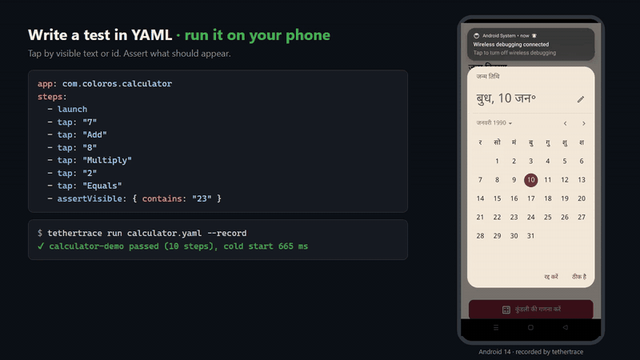
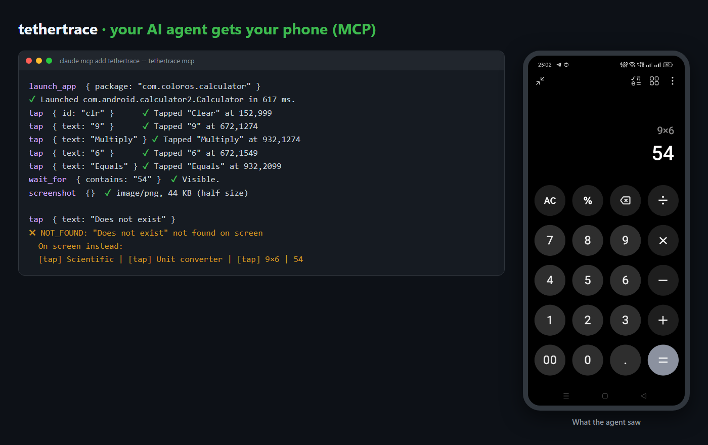
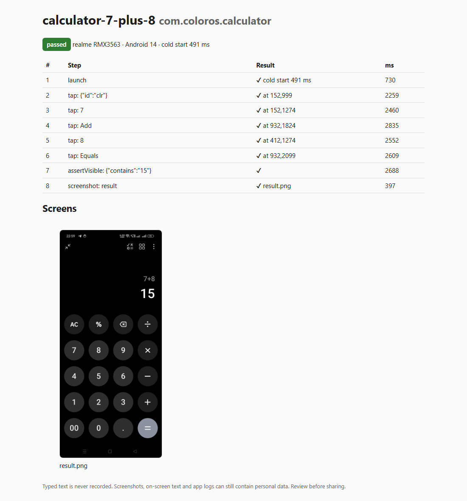

<div align="center">

# tethertrace

**Give it your APK. It tests your app on your real phone over Wi-Fi.**<br>
No `adb`. No Android SDK. No test code. No cloud. Works with Claude, Codex and local models.

[](https://github.com/Saurabhzz9/tethertrace/actions/workflows/ci.yml)
[](LICENSE)


</div>

<p align="center">
  
  <br><sub>A real run on an Android 14 phone. The phone footage was recorded by tethertrace itself (<code>--record</code>).</sub>
</p>

```bash
npm install -g github:Saurabhzz9/tethertrace
tethertrace pair 123456          # once, with the code from Wireless debugging
tethertrace test app-release.apk # install, explore, catch crashes. No test code.
```

## Building an Android app? Just give it your APK

```bash
tethertrace test app-release.apk
```

That one command installs the APK over Wi-Fi, cold-starts it, **walks through your screens by itself** (tapping what it can see), and watches for crashes and freezes. You get:

- a report with a screenshot of every screen it reached and the cold-start time,
- the exact tap that crashed the app, the crash lines, and a `repro.yaml` that reproduces it,
- an `explored-flow.yaml` you can keep as a regression test and re-run with `tethertrace run`,
- a coverage level next to the verdict (`ok`, `limited` or `none`), so "no crash observed" on a canvas UI or game it couldn't tap never looks like a pass.

It never types, declines permission prompts, never flips switches or checkboxes, never opens floating windows or picture-in-picture, and skips anything that looks destructive or outward-facing (delete, pay, buy, send, share, log out…, in English and Hindi). Add your own with `--deny "reset|archive"`. Add `--record` to get a video of the whole run.

Works with native Views, Jetpack Compose, Flutter and React Native, because it tests the built app, not your source code.

## No APK yet? Build it too

```bash
tethertrace doctor          # what is in this folder, and what a build needs
tethertrace build --test    # build, install on your phone, explore for crashes
```

`build` runs your project's own build (the Gradle wrapper, or `flutter build apk`) and works out the JDK and Android SDK it needs. It uses what is already on your computer. If something is missing, it asks before downloading the smallest set that can compile an app (a JDK, Google's SDK command-line tools and the one platform your project targets), verifies the checksums, and keeps it in `~/.tethertrace`. You do not need Android Studio, and you do not set `JAVA_HOME` or `ANDROID_HOME`.

A failed build comes back with a category (`compile_error`, `jdk_incompatible`, `dependency_download_failed`, …) and the lines that matter. Details and limits: **[docs/build.md](docs/build.md)**.

## Why

- **Nothing to install but Node.** tethertrace speaks the ADB wire protocol itself in TypeScript: wireless pairing (TLS 1.3 + SPAKE2), the encrypted connection, shell, install, screenshots. No `adb.exe`, no 150 MB platform-tools, no USB drivers.
- **Any app.** Point it at an APK or a package name; it reads the package straight from the APK.
- **Honest answers when something breaks.** Every failure is labelled (`element_not_found`, `app_crash`, `anr`, `app_exited`, `device_disconnected`, …) and comes with the screenshot, what *was* on screen, and only your app's logs. "No crash observed" is never sold as "everything works".
- **Built for AI agents.** An MCP server lets Claude Code, Codex, Gemini CLI, Cursor or any MCP client see the screen, tap, type, install and run tests on the phone in your hand. AI is optional: the CLI is fully deterministic without it.

## Quick start

You need **Node.js 22+** and an **Android 11+** phone on the same Wi-Fi.

```bash
npm install -g github:Saurabhzz9/tethertrace
```

1. On the phone: **Settings → Developer options → Wireless debugging → On**.
2. Tap **Pair device with pairing code** and run, with the code you see:

   ```bash
   tethertrace pair 123456
   ```

3. Done. From now on just turn Wireless debugging on and use it:

   ```bash
   tethertrace info
   tethertrace test path/to/your-app.apk   # explore + crash check, no setup
   tethertrace smoke --apk path/to/your-app.apk
   tethertrace ui                          # what's on screen
   tethertrace tap "Sign in"               # tap by visible text
   tethertrace run examples/android-settings-tour.yaml
   ```

The phone is found automatically over mDNS. Pass `--device 192.168.1.20:41235` (or set `TETHERTRACE_DEVICE`) if you have several.

## Use it from Claude, Codex and other AI tools

```bash
# Claude Code
claude mcp add tethertrace -- tethertrace mcp
```

```toml
# Codex: ~/.codex/config.toml
[mcp_servers.tethertrace]
command = "tethertrace"
args = ["mcp"]
```

Then ask: *"Install app-release.apk on my phone, open the login screen, try signing in with the test account and tell me why it fails."*

<p align="center"></p>

The agent gets these tools: `discover_devices`, `pair_device`, `select_device`, `device_info`, `list_apps`, `apk_info`, `screenshot`, `ui_tree`, `wait_for`, `tap`, `type_text`, `press_key`, `scroll`, `swipe`, `launch_app`, `stop_app`, `install_apk`, `app_logs`, `smoke_test`, `explore_app`, `run_flow`, `record_screen`, `explain_report`. Tests can record the screen with `record: true`.

Safety is enforced by the server, not left to the client:

- `--read-only`: look, never touch.
- `--package com.my.app`: refuses to read or touch the screen while any other app is in front.
- `--allow-shell`: raw shell is off unless you add this.
- `--confirm install,execute`: a person approves each such call.
- Every decision goes to a local audit log.

Details: [docs/mcp.md](docs/mcp.md#security-model).

Gemini CLI, Cursor, VS Code, Claude Desktop and local models (Ollama, LM Studio): see **[docs/mcp.md](docs/mcp.md)**.

### Agent skill

[`skills/tethertrace/SKILL.md`](skills/tethertrace/SKILL.md) teaches an agent when to reach for tethertrace and how to use it well: checking the phone connection, picking `test`, `smoke` or `run`, writing flows from the real labels, reading verdicts and coverage honestly, and the safety rules. It ships with the package. For Claude Code:

```bash
mkdir -p ~/.claude/skills && cp -r "$(npm root -g)/tethertrace/skills/tethertrace" ~/.claude/skills/
```

```powershell
# Windows PowerShell
New-Item -ItemType Directory -Force "$HOME\.claude\skills" | Out-Null; Copy-Item -Recurse "$(npm root -g)\tethertrace\skills\tethertrace" "$HOME\.claude\skills\"
```

Codex, Cursor and other agents that read `SKILL.md`: copy the same folder into their skills directory. The skill works with the MCP server connected or with the CLI alone.

## Write a test in YAML

```yaml
app: com.example.app
name: login
steps:
  - launch
  - tap: "Sign in"                 # visible text or accessibility label
  - tap: { id: email }             # or { desc: ... } / { contains: ... } / { index: 1 }
  - type: "${TEST_EMAIL}"          # secrets come from env vars and never reach reports
  - key: enter
  - waitFor: "Home"
  - assertVisible: { contains: "welcome" }
  - screenshot: home
```

```bash
tethertrace run login.yaml
```

Every run writes an HTML report. When a step fails you get the category, the screenshot, the list of what was on screen instead, and the app's own logs. Full reference: **[docs/flows.md](docs/flows.md)**.

<p align="center"></p>

### Let your AI write the tests for your app

Flows are plain YAML written for *your* app: its screens, its labels, its ids. You don't have to write them by hand:

- **From an AI agent.** With the MCP server connected, the agent can read your app's source code, open each screen on the phone, look at the real labels with `ui_tree`, write the YAML, run it with `run_flow`, and fix it until it passes. The server ships a ready-made prompt for this, `write_test` (in Claude Code it shows up as the slash command `/mcp__tethertrace__write_test`), or just ask:

  > *"Write a tethertrace test for com.example.app that proves a user can log in with the test account. Read the source, check the real labels on my phone, save it to flows/login.yaml and run it until it passes."*

- **From the explorer.** `tethertrace test app.apk` saves `explored-flow.yaml`, a working flow through every screen it reached, as a starting point.

- **From `tethertrace ui`.** Open a screen and copy the labels and ids it prints.

Keep your app's flows in your app's repo and run them on every build.

## Ask an AI why it failed (optional)

```bash
tethertrace explain reports/login-2026-11-07                    # no AI, just the evidence
tethertrace explain reports/login-2026-11-07 -m anthropic       # Claude (ANTHROPIC_API_KEY)
tethertrace explain reports/login-2026-11-07 -m openai:<model>  # OpenAI (OPENAI_API_KEY)
tethertrace explain reports/login-2026-11-07 -m ollama:qwen3:8b # local, nothing leaves your machine
tethertrace explain reports/login-2026-11-07 -m lmstudio:<model>
```

The model only sees the report folder and is told to quote evidence and say "unknown" when the evidence is thin. tethertrace's own verdict stays the source of truth.

## Build your own AI phone agent on top of it

tethertrace is also a library. Anything a person can do on their own phone (read what's on screen in **any** app, tap, type, open apps, take screenshots), your code can do over Wi-Fi, with no app to install on the phone. That makes it a base for your own AI products:

- a personal assistant that reads incoming messages and drafts replies for you to approve,
- an accessibility helper that reads screens aloud or does repetitive taps,
- a QA bot that tests every build on real phones,
- store-screenshot and demo-video generators,
- monitoring that opens an app every hour and checks it still works.

```js
import { Device, discover, loadOrCreateKey, SERVICE_CONNECT } from "tethertrace";

const key = await loadOrCreateKey();                       // paired once with `tethertrace pair`
const [phone] = await discover({ services: [SERVICE_CONNECT] });
const d = await Device.connect({ host: phone.host, port: phone.port, key });

const screen = await d.uiNodes();             // every label, button and id on screen, as data
const png = await d.screenshotScaled(0.5);    // or an image for a vision model

// ...let your model decide what to do, then:
await d.tap("Reply");                          // by visible text, { id }, { desc } or { contains }
await d.type("On my way!");
d.close();
```

Or skip the code and give an agent the MCP server (above): it gets the same powers as tools.

**Use it responsibly.** Only on your own phone and your own accounts, with the person's consent. Keep a human approval step before anything that sends a message, posts, pays or deletes. Many apps (especially messaging apps) forbid automated use in their terms, so check them first; never use it for spam or bulk messaging. Scope agents with `--package` and `--read-only` wherever you can. `type` sends ASCII only, so non-Latin replies need another input route.

## All commands

| Command | What it does |
|---|---|
| `discover` | Find phones with Wireless debugging on this network |
| `pair [host:port] <code>` | Pair once with the 6-digit code |
| `info` | Model, Android version, ABI |
| `apps` · `apk-info <apk>` | Installed apps · package/version of an APK |
| `install <apk>` · `launch <pkg>` · `stop <pkg>` | Install over Wi-Fi · cold start with launch time · force-stop |
| `screenshot` · `ui` · `logs <pkg>` | Screen PNG · on-screen elements · one app's logcat |
| `record` · `--record` | Record the screen on its own, or during `run`, `test` and `smoke` (saved in the report) |
| `tap` · `type` · `key` · `scroll` | Interact by visible text, id or description |
| `test <apk or package>` | Zero-config: install, explore screens, catch crashes, write report + flows |
| `smoke` | Install (optional) → cold start → watch → evidence + verdict |
| `run <flow.yaml>` | Run a YAML test with a full report |
| `explain <report>` | Summarise a report, optionally with an AI model |
| `mcp` | MCP server for AI agents |
| `shell <cmd>` | Run a shell command on the phone |

## How it works

```text
your computer                                             your phone (Android 11+)
┌────────────────────────────────────────────┐            ┌────────────────────────┐
│ tethertrace (Node, TypeScript)              │   Wi-Fi    │ adbd (Wireless         │
│  mDNS discovery ──────────────────────────────────────▶ │  debugging)            │
│  pairing: TLS 1.3 → SPAKE2 → AES-128-GCM   │            │                        │
│  connect: CNXN → STLS → TLS 1.3 (paired key)│◀────────▶ │  shell · exec · install│
│  YAML runner · evidence · classifier       │            │  uiautomator · logcat  │
│  MCP server ◀── Claude / Codex / any agent │            │  screencap             │
└────────────────────────────────────────────┘            └────────────────────────┘
```

Details, including how compatibility with Google's `adb` was checked: **[docs/how-it-works.md](docs/how-it-works.md)**.

## Status

Version 0.1, early. What has been verified, and where:

| Area | Verified |
|---|---|
| Pairing (and reconnecting after Wireless debugging is toggled), TLS connect, discovery | Physical **realme RMX3563, Android 14**, Windows 11 host, home Wi-Fi |
| Apps of different kinds on that phone | A Flutter app (install 81.6 MB, 20-step flow across 6 screens), system Settings (scroll, search + typing), the native Calculator (taps by id and label, result asserted), the Clock app (smoke) |
| MCP server | Driven over stdio by the official MCP SDK client against that phone: screenshot, UI tree, taps, logs, APK-only smoke test, `--read-only` enforcement |
| Wire compatibility | Google's `adb` 1.0.41 pairs, connects and runs shell against tethertrace's protocol implementation (test harness) |
| Zero-config `test` explorer | On that phone against a Flutter app: 10–15 screens per run, no crash, share buttons and 5 settings toggles correctly skipped; plus mock tests for crash + repro and replaying the generated flow |
| Screen recording | On that phone, whose built-in `screenrecord` crashes: tethertrace fell back to screenshot frames (~4–6 fps) and produced the video at the top of this page |
| Everything | 40 automated tests against a mock device |
| Not yet verified | Other phone brands and Android versions, macOS/Linux with a real phone, each AI client's own setup (the MCP protocol itself is tested), iOS (not supported) |

If you try it on another phone, please [tell us how it went](https://github.com/Saurabhzz9/tethertrace/discussions). That is the most useful contribution right now.

## Limitations

- Android only. iPhones use a different protocol (on the roadmap).
- `type` sends ASCII only (an Android `input text` limitation).
- Elements are found through the accessibility tree: text in custom-drawn canvases, games and secure screens (banking, passwords) is invisible to it.
- Some phones switch Wireless debugging off when the screen locks or Wi-Fi changes. Turn it on again; pairing is remembered.

## Security and privacy

- Wireless debugging gives full shell access to the phone. Only enable it on networks you trust, and turn it off when you're done.
- Nothing is sent anywhere: no telemetry, no accounts. Reports stay in `./reports`.
- Typed text never appears in reports. Screenshots, on-screen text and app logs can still contain personal data, so review a report before sharing it.
- Report vulnerabilities privately: [SECURITY.md](SECURITY.md).

## Roadmap

- Run the same flow on several phones in parallel
- Record a flow by using the app
- Portable, redacted repro bundles (`.zip`) you can attach to an issue
- iOS (logs, screenshots, install) without a Mac

## Contributing

Issues and pull requests are welcome. `main` is protected: every change goes through a pull request reviewed by the maintainer. See [CONTRIBUTING.md](CONTRIBUTING.md).

## Used tethertrace?

If it helped you ship or debug something, a ⭐ helps others find it. And we'd love to hear about it in [Discussions → Show and tell](https://github.com/Saurabhzz9/tethertrace/discussions): which phone, which kind of app, what broke, what worked.

## Also by the maker

- [indiedex.xyz](https://indiedex.xyz/)
- [resumeworlds.com](https://www.resumeworlds.com/)

## License

[MIT](LICENSE)
